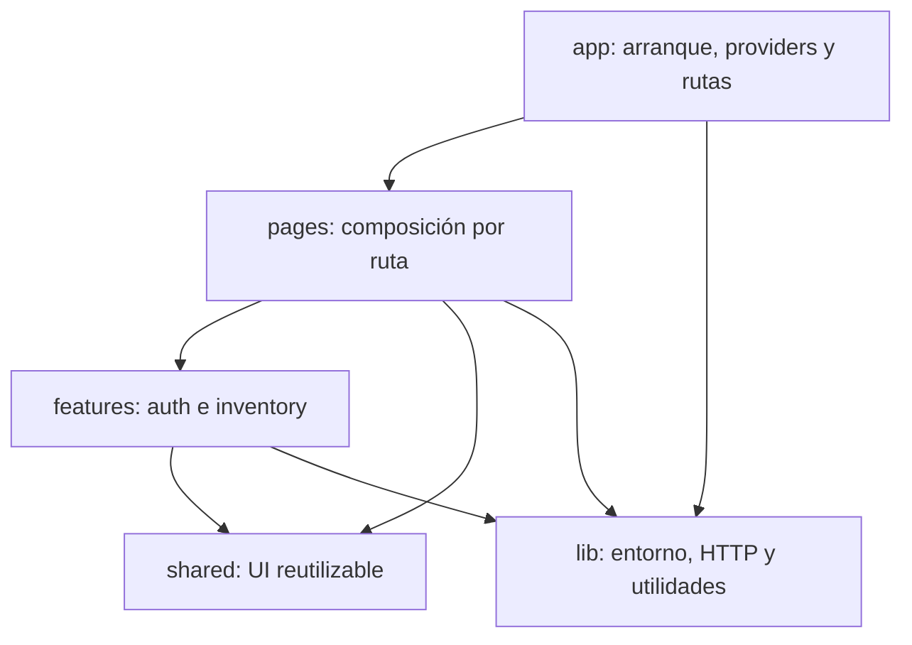

# Arquitectura del frontend

El frontend vive en `frontend/` como un paquete independiente del backend. Usa
React, TypeScript estricto y Vite; Node 24 es la versión LTS de referencia
(`frontend/.nvmrc`). React Router resuelve las rutas y TanStack Query será la
fuente de verdad para el estado del servidor. React Hook Form administra
formularios y Zod valida sus datos y la configuración.

## Dependencias entre carpetas

- `app/` configura providers y rutas; no contiene reglas de negocio.
- `pages/` compone la vista asociada a una ruta; no realiza llamadas HTTP.
- `features/auth/` y `features/inventory/` encapsulan cada dominio y publican
  su API mediante `index.ts`.
- `shared/` ofrece elementos reutilizables y nunca importa desde `features/`.
- `lib/` aloja infraestructura sin componentes visuales, incluida la
  configuración del entorno, el almacenamiento de sesión y el cliente HTTP.

## Decisiones iniciales

- `react-router-dom` separa la navegación de la presentación de las páginas.
- `@tanstack/react-query` manejará caché, sincronización y estados de datos del
  servidor; no se duplicarán en estado global.
- La política inicial de consultas conserva datos frescos por 30 segundos, no
  refetch al enfocar la ventana, refetch al reconectar y reintenta una sola vez
  los errores de red/servidor, nunca los HTTP 4xx.
- `react-hook-form` administrará el estado de formularios.
- `zod` validará configuración y datos de formularios.
- `@hookform/resolvers` conecta la validación Zod del login con React Hook Form.
- ESLint y Prettier tienen configuraciones y comandos independientes.
- Vitest y React Testing Library verifican el arranque y la navegación del
  shell sin depender de la API.
- Los contratos de las operaciones de autenticación e inventario se derivan de
  `frontend/src/shared/api/schema.d.ts`, generado desde el OpenAPI del backend.
- El cliente HTTP central añade Bearer si hay sesión, respeta cancelación y
  timeout, conserva `X-Request-Id` y traduce el error estándar a `ApiError`.
  La API expone el header por CORS para que el navegador pueda leerlo.
- El token se guarda en `sessionStorage` y el cliente lo elimina ante HTTP 401.
  Como cualquier almacenamiento accesible desde JavaScript, `sessionStorage`
  puede exponerse ante XSS; el backend actual no ofrece cookies HttpOnly ni
  refresh token.
- `SessionProvider` usa TanStack Query para obtener la identidad canónica desde
  `/auth/me`. Un 401 limpia sesión y caché; un 403 conserva la sesión y muestra
  acceso denegado.
- La UI muestra controles de ajustes solo a ADMIN y WAREHOUSE. Es una ayuda de
  experiencia, no sustituye la autorización del servidor.

La URL de API se configura con `VITE_API_BASE_URL`; se documenta un valor local
en `frontend/.env.example`. No se guarda ningún token, contraseña ni URL de
producción en el repositorio. La pantalla de inventario actual es únicamente un
placeholder; su integración con la API se completará en las siguientes etapas.
