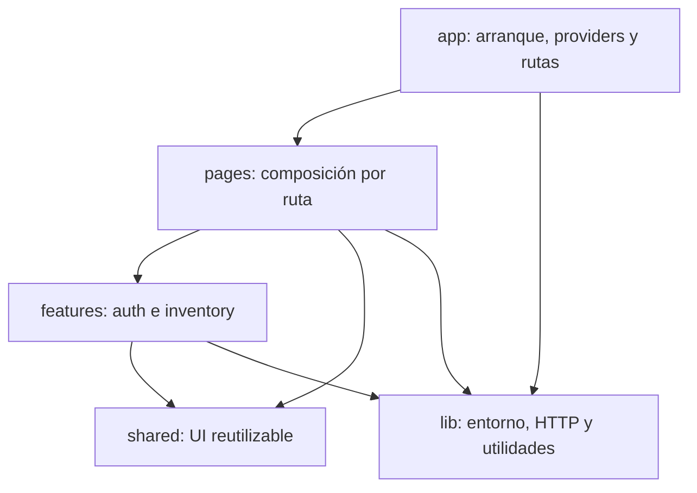

# Arquitectura del frontend

El frontend vive en `frontend/` como un paquete independiente del backend. Usa
React, TypeScript estricto y Vite; Node 24 es la versión LTS de referencia
(`frontend/.nvmrc`). React Router resuelve las rutas y TanStack Query será la
fuente de verdad para el estado del servidor. React Hook Form administra
formularios y Zod valida sus datos y la configuración.

## Dependencias entre carpetas

- `app/` configura providers y rutas; no contiene reglas de negocio.
- `pages/` compone la vista asociada a una ruta; no realiza llamadas HTTP.
- `features/auth/` y `features/inventory/` encapsulan cada dominio y publican
  su API mediante `index.ts`.
- `shared/` ofrece elementos reutilizables y nunca importa desde `features/`.
- `lib/` aloja infraestructura sin componentes visuales, incluida la
  configuración del entorno y el futuro cliente HTTP.

## Decisiones iniciales

- `react-router-dom` separa la navegación de la presentación de las páginas.
- `@tanstack/react-query` manejará caché, sincronización y estados de datos del
  servidor; no se duplicarán en estado global.
- `react-hook-form` administrará el estado de formularios.
- `zod` validará configuración y datos de formularios.
- ESLint y Prettier tienen configuraciones y comandos independientes.
- Vitest y React Testing Library verifican el arranque y la navegación del
  shell sin depender de la API.

La URL de API se configura con `VITE_API_BASE_URL`; se documenta un valor local
en `frontend/.env.example`. No se guarda ningún token, contraseña ni URL de
producción en el repositorio. La pantalla de inventario actual es únicamente un
placeholder: la integración con la API y el flujo de autenticación pertenecen
a las siguientes ramas de la semana.
